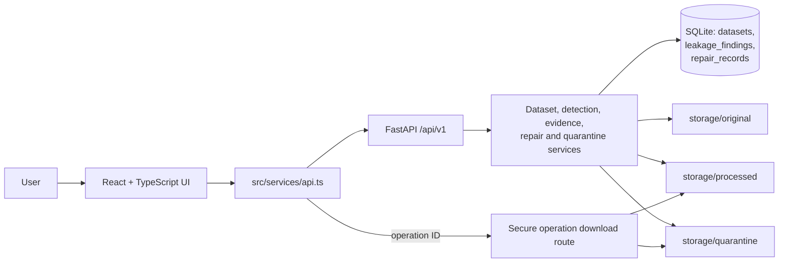

# DataLeakGuard-CV

An evidence-oriented dataset integrity and leakage review application for tabular machine-learning data. The implemented analysis and repair workflows support CSV and XLSX datasets; ZIP uploads have a limited image-profiling path, not computer-vision leakage analysis.

> **Project status:** Core dataset, finding, evidence, repair, quarantine, model-artifact metadata, provenance metadata, distribution comparisons, impact counts, and JSON/HTML report paths are present. This is a final-year project, not a production-ready security product.

## Contents

1. [Overview and objectives](#overview-and-objectives)
2. [Features and scope](#features-and-scope)
3. [Technology stack](#technology-stack)
4. [Architecture](#architecture)
5. [Project structure](#project-structure)
6. [Phases and implementation status](#phases-and-implementation-status)
7. [Leakage analysis and evidence](#leakage-analysis-and-evidence)
8. [Repair, quarantine, and combined repair](#repair-quarantine-and-combined-repair)
9. [Database and migrations](#database-and-migrations)
10. [API overview](#api-overview)
11. [Installation and configuration](#installation-and-configuration)
12. [Running the application and user workflow](#running-the-application-and-user-workflow)
13. [Testing and verification](#testing-and-verification)
14. [Security, limitations, and future work](#security-limitations-and-future-work)
15. [Troubleshooting](#troubleshooting)
16. [Final project status](#final-project-status)

## Overview and objectives

### Problem statement

Duplicate records, shared entities across train/test splits, target-correlated features, temporal overlap, and repeated samples across splits can undermine model evaluation. DataLeakGuard-CV helps a user inspect these risks, retain detector evidence, and create separate repair or quarantine outputs for supported cases.

### Objectives and users

The primary users are dataset owners, ML practitioners, and project evaluators who need to:

- upload and profile a dataset before analysis;
- run applicable checks using actual dataset columns;
- review persistent findings and their evidence;
- explicitly repair supported exact duplicates or quarantine rows with deterministic row-index evidence;
- preserve an auditable operation history and download generated outputs.

The current application is focused on structured CSV/XLSX workflows. It does not provide general model retraining, model-performance comparison, or image/CV leakage analysis.

## Features and scope

### Implemented and backend-backed

- CSV/XLSX upload, size/format validation, SHA-256 calculation, and tabular profiling.
- ZIP upload for basic image-archive profiling only.
- Exact duplicate, entity overlap, target leakage, temporal leakage, and train/test contamination detection.
- Persistent findings and detector evidence, including finding detail/evidence retrieval.
- Analysis-page column selectors and execution-derived detector stage statuses.
- Individual exact-duplicate repair and row quarantine for supported finding types.
- Combined, explicitly selected exact-duplicate repair into one cleaned copy.
- Operation history and individual operation downloads.
- Download path containment and stored-output SHA-256 verification.
- Dataset deletion protection when findings/operations exist; otherwise only the database row is removed and the original file is retained.

### Partial or not implemented

Model integrity is implemented as owner-scoped artifact registration, storage, and SHA-256 verification; inference provenance stores metadata and explicitly records `no_prediction`; distribution shift stores tabular comparisons; impact metrics store finding/operation counts; and reports are persisted and downloadable as JSON or HTML. Model execution, retraining, behavioral verification, accuracy comparison, PDF generation, and fabricated predictions are not implemented.

The model, provenance, distribution, impact, and report screens now call the
corresponding backend workflows. Browser coverage is still incomplete; see
[`DataLeakGuard-CV_E2E_TEST_REPORT.md`](DataLeakGuard-CV_E2E_TEST_REPORT.md) for
the verified and unverified scenarios.

## Technology stack

| Area | Repository implementation |
|---|---|
| Frontend | React 19, TypeScript, Vite 8, React Router |
| UI/visualization | Tailwind CSS Vite plugin, Lucide, Recharts, Motion |
| Backend | Python, FastAPI, Uvicorn |
| Persistence | SQLAlchemy 2, Pydantic 2, SQLite by default |
| Data processing | Pandas, OpenPyXL; Pillow for ZIP image profiling |
| Tests | Pytest and FastAPI TestClient; Node's test runner with `tsx` for frontend tests |

Exact supported Python/Node versions are not pinned in project metadata. Use Python 3.10+ (the source uses modern union type syntax) and a Node.js release supported by the installed Vite 8 version.

## Architecture

The frontend service layer calls the FastAPI API. Dataset/finding/operation metadata is persisted in SQLite through SQLAlchemy. Uploaded originals and generated outputs are separate filesystem artifacts; output downloads look up operation metadata rather than accepting client-provided paths.



The backend separates route handling (`backend/app/api/v1`) from data processing/services and storage utilities. The frontend pages use `src/services/api.ts`; legacy simulator helpers remain in the service module but are not used for the implemented persisted workflows. CORS is configured in `backend/app/core/config.py`; the Vite development server uses port 3000, and the backend is commonly run on port 8000.

## Project structure

```text
.
├── backend/
│   ├── app/
│   │   ├── api/v1/             # FastAPI routers
│   │   ├── core/               # Settings and dataset service
│   │   ├── db/                 # SQLAlchemy models, schemas, sessions
│   │   ├── schemas/            # API response schemas
│   │   ├── services/           # Detection, evidence, repair, quarantine
│   │   └── utils/              # File storage, hashing, profiling
│   ├── migrations/             # Explicit SQLite migration and instructions
│   ├── tests/                  # API, service, migration, integration tests
│   ├── storage/                # original/, processed/, quarantine/ (runtime data)
│   ├── app/main.py             # FastAPI app and router/CORS registration
│   └── requirements.txt
├── src/
│   ├── components/             # Shared UI and evidence components
│   ├── context/                # Frontend contexts, including auth UI state
│   ├── data/                   # Mock data for incomplete areas
│   ├── pages/                  # Analysis, datasets, leakage, repair, etc.
│   ├── services/api.ts         # Backend API and legacy simulator helpers
│   └── types/                  # Frontend domain types
├── package.json
├── vite.config.ts
└── README.md
```

`backend/storage/` and database files are runtime/user data and intentionally omitted from this source tree. Do not commit real datasets or generated outputs.

## Phases and implementation status

The phase names below reflect the project context and the current source. Historical test claims are not a fresh test run for this README task.

| Phase | Objective and implementation | Main modules / API | Status and limits |
|---|---|---|---|
| **1 — Backend Foundation** | FastAPI app, configuration, SQLAlchemy session/base, CORS, health, authentication and owner-scoped routes. | `backend/app/main.py`, `core/config.py`, `db/`; `GET /api/v1/health`, auth routes | Implemented in source. Deployment schema/configuration and production security still require environment-specific verification. |
| **2 — Upload and Profiling** | Validate accepted type/extension, enforce configured upload size, store original under a generated name, hash it, profile tabular data and persist metadata/preview. ZIP supports basic image profiling. | `api/v1/datasets.py`, `core/dataset_service.py`, `utils/file_storage.py`, profiling utilities; `POST /api/v1/datasets` and dataset read/profile routes | Implemented for supported upload paths. CSV/XLSX are the supported tabular formats; ZIP does not enable CV leakage detection. |
| **3 — Leakage Detection and Findings** | Run detectors against stored data and persist findings in `leakage_findings`. | `services/leakage_detection_service.py`; `POST /api/v1/datasets/{id}/analyze/leakage`, finding-list/detail routes | Five detector functions exist. Findings are heuristic signals and require human review. |
| **4 — Evidence Architecture** | Preserve structured detector evidence and expose finding evidence with source metadata. | `services/evidence_service.py`, evidence schemas, `api/v1/findings.py`; `GET /api/v1/findings/{id}/evidence` | Implemented. Evidence detail varies by detector; temporal findings do not provide deterministic row indices for automated row selection. |
| **5 — Repair, Quarantine, History** | Create separate repaired copies or quarantine subsets, persist operation records, expose history and secure output download. | `services/repair_service.py`, `quarantine_service.py`, `RepairRecord`; repair/quarantine/history/download routes | Implemented for supported operations. Originals are read, not rewritten. Quarantine is an output containing evidenced affected rows, not deletion from the original. |
| **Combined Repair / Remediation** | Preview and confirm exact-duplicate cleaning or evidence-backed detector-specific transformations; persist plans, outputs and verification. | `services/remediation_service.py`; `/remediation-plans/*`, remediation artifact downloads | Supported transformations are bounded by evidence/configuration. Unsupported or unresolved findings remain review-required; no general causal repair is claimed. |
| **6 — Analysis Setup and Results** | Separate manual/recommended column setup from analysis execution; display configuration, applicability, findings and skipped checks. | `AnalysisSetupPage.tsx`, `AnalysisPage.tsx`, dataset analysis API | Implemented with advisory recommendations and explicit confirmation. Browser E2E remains unverified for the current maintenance snapshot. |
| **7 — Consolidated Remediation Center** | Detector-grouped, paginated findings, backend-validated selection, preview, confirmation, history and artifact access. | `RemediationCenterPage.tsx`, findings/remediation APIs | Implemented with server-side pagination and owner-scoped plan validation. Large-scale performance and live browser workflows remain unverified. |
| **8 — Verification and Preprocessing** | Re-evaluate selected detector conditions on output; support optional train-only missing-value imputation. | Remediation verification service; `/preprocessing/imputation/{preview,execute}` | Implemented for supported checks and CSV output. Imputation fits on the selected training partition only; it does not alter source uploads. |
| **Frontend integration work** | Connect analysis, persisted findings/evidence and repair operations to the UI; show truthful stage and operation states. | `AnalysisPage.tsx`, `LeakageAnalysisPage.tsx`, `RepairPage.tsx`, `api.ts` | Core workflows and the scoped artifact/provenance/distribution/impact/report screens are API-backed; fresh browser coverage remains incomplete. |

## Leakage analysis and evidence

`POST /api/v1/datasets/{dataset_id}/analyze/leakage` always runs exact-duplicate detection. Optional query columns control additional detectors:

| Detector | Required configuration | What it flags |
|---|---|---|
| Exact duplicates | None | Identical row content (the split column and an `id` field are excluded from this check when a split is supplied). |
| Entity overlap | `entity_column` and `split_column` | Entity values occurring in multiple splits. |
| Target leakage | `target_column` | Exact feature/target equality or deterministic feature-to-target associations; this is a review signal, not proof of causal leakage. |
| Temporal leakage | `time_column` and `split_column` | Overlap of split time ranges, using conventional split ordering where recognized and fallback ordering otherwise. |
| Train/test contamination | `split_column` | Matching row content across distinct split values, excluding the split and an `id` column. |

Column names must exist in the uploaded dataset. The API rejects invalid combinations/columns. The Analysis page represents detectors as not run, needs configuration, running, completed, failed, or skipped; progress should be interpreted from actual execution, not as proof that all possible checks ran.

Findings store an ID, dataset ID, type, severity, status, description, JSON evidence, and creation time. The evidence endpoint returns finding fields, optional source filename/hash, and `detector_evidence`. Row indices are zero-based positions in the source dataframe where the detector supplies them. Configured composite entity keys and contamination comparison keys are supported; missing key components are excluded from matching and reported as review-required, not as a clean result. Target and time-dependent checks require explicit configuration. The temporal objective is recorded; randomized-holdout chronology is skipped rather than reported as passed. Finding status changes are persisted only by verified supported remediation paths.

## Repair, quarantine, and combined repair

### Individual operations

- **Repair** supports exact-duplicate findings. It writes a processed CSV/XLSX with later occurrences removed and the first occurrence retained.
- **Quarantine** supports exact duplicates, entity overlap, and train/test contamination when evidence contains deterministic row indices. It writes affected rows to a separate quarantine file.
- Neither operation changes the uploaded original. Operation records include the source/output hashes, output filename, operation type/status, affected-row information, and timestamps.
- Repeated equivalent completed requests are checked before output creation in the supported service flow.

### Combined exact-duplicate workflow

1. Choose a dataset and run leakage analysis.
2. Review open exact-duplicate findings and select the findings to apply.
3. Submit the selected finding IDs to the combined-repair endpoint.
4. The service validates dataset ownership, finding type/status and evidence against the source, then removes duplicate rows from one copy of the original.
5. Overlapping row groups are accumulated in a set, so a row is removed/counts once. The first occurrence of each duplicate group is kept.
6. Findings that are stale, malformed, non-open, or already repaired are skipped with reasons in operation metadata. If no eligible rows remain, generation is rejected rather than returning a false success.
7. A uniquely named processed CSV/XLSX is written. Input/output SHA-256, selected/applied IDs, skipped reasons, original/final row counts, and removed-row count are persisted in `operation_metadata`.
8. Download by the persisted operation ID. The download route selects the storage directory from operation type, validates the stored basename and resolved path, and checks the output hash when one is recorded.

**Previously reported isolated result (not run for this README task):** the migration and combined-repair focused tests reported **10 passed, 0 failed, 14 warnings** in a disposable project copy/database. A sample operation used 8 data rows, removed 2 duplicates, and produced 6 rows, with two applied finding IDs and input/output SHA-256 hashes. The report states the real database, backup, and storage artifacts were not modified.

The consolidated remediation-plan API can also apply explicitly selected,
evidence-backed actions: keep-first duplicate removal; group-aware split
rebuilding (all rows for a configured single/composite entity remain together);
confirmed target-feature exclusion while retaining the target; chronological
split rebuilding with an explicit cutoff; and contamination handling only
after an explicit retained-partition choice or evidence-backed quarantine.
Unsupported actions remain review-only. The uploaded source is preserved.
Remediation output verification reopens actual output bytes and reports
passed/failed/skipped/review-required checks; skipped checks do not count as
passed, and unresolved findings are not described as repaired.

Optional missing-value preprocessing is a separate, explicit workflow. Mean,
median, mode, constant and leave-missing strategies are previewed; fitted
statistics come only from the user-selected training partition and are applied
to a separate CSV copy. Configured target, entity, comparison-key, timestamp
and split columns are protected from imputation. Operation metadata records
fitted values, missing counts, hashes and post-operation verification.

## Database and migrations

The default is `DATABASE_URL=sqlite:///./test.db`. Because the path is relative to the process working directory, starting Uvicorn from `backend/` uses `backend/test.db`. Configuration is in `backend/app/core/config.py`; sessions are created in `backend/app/db/session.py`.

| Table/model | Purpose and notable fields |
|---|---|
| `datasets` / `Dataset` | Dataset identity, name/type/format, counts/status, upload/analysis timestamps, description, stored original filename/hash, profile, columns, preview and optional CV stats. |
| `leakage_findings` / `LeakageFinding` | Dataset-linked finding type/severity/status/description, JSON evidence and creation time. The finding model declares a foreign key to `datasets.id`. |
| `repair_records` / `RepairRecord` | Repair, quarantine and combined operation history: IDs, dataset/finding IDs, type/status, input/output hashes, output name, affected rows/columns, optional operation metadata, timestamps and error information. Dataset/finding IDs are not declared as foreign keys on this model; services perform workflow validation. |

Operation metadata is nullable JSON and is used by combined repair for provenance and row counts. `backend/migrations/add_operation_metadata.py` is an explicit, forward-only SQLite migration: it adds `repair_records.operation_metadata JSON` when absent and returns a no-op when present. It refuses a missing database/table; there is no Alembic or startup migration runner.

The current project investigation found that `backend/test.db` already contains the nullable column, and the verified backup had matching schema and all 14 existing repair records. The cause of the column's prior appearance is not established. No migration was run for this README task.

Before migrating a database: stop the backend gracefully, make a uniquely named SQLite backup using SQLite's backup API (rather than copying only a live DB file), verify it opens and passes `PRAGMA integrity_check`, compare tables/row counts/important records, test the migration on a disposable database, then run the explicit migration with `--database`. Keep the backup and migrated database separate. See [`backend/migrations/README.md`](backend/migrations/README.md).

## API overview

The API prefix defaults to `/api/v1`. Swagger UI is available at `http://127.0.0.1:8000/docs` when the backend is running.

### Persisted workflow endpoints

| Method | Endpoint | Purpose |
|---|---|---|
| POST/GET | `/model-artifacts` | Register or list owned model artifacts |
| GET | `/model-artifacts/{id}/verify` | Recompute and compare the artifact SHA-256 |
| GET | `/model-artifacts/{id}/download` | Download an owned artifact |
| POST/GET | `/provenance` | Store or list metadata-only provenance records |
| POST/GET | `/distribution-comparisons` | Compare and list owned tabular dataset distributions |
| POST/GET | `/impact-metrics` | Persist or retrieve finding/operation impact counts |
| POST/GET/DELETE | `/reports` | Create, list, or delete persisted reports |
| GET | `/reports/{id}/download?format=json\|html` | Download the persisted report payload |

These endpoints require the existing authenticated session and CSRF protections. They do not execute models or claim model-performance improvements.

| Method and path | Purpose |
|---|---|
| `GET /api/v1/health` | Basic health response. |
| `POST /api/v1/datasets` | Multipart upload (`name`, `type`, `format`, `description`, `file`). |
| `GET /api/v1/datasets?skip=&limit=` | List datasets. |
| `GET /api/v1/datasets/{dataset_id}` | Dataset metadata. |
| `GET /api/v1/datasets/{dataset_id}/profile` | Dataset/profile response. |
| `DELETE /api/v1/datasets/{dataset_id}` | Delete database row only; blocked with HTTP 409 if findings/operations exist; original retained. |
| `POST /api/v1/datasets/{dataset_id}/analyze/leakage` | Run exact duplicates and configured optional detectors; accepts `entity_column` or repeated `entity_columns`, `contamination_key_columns`, `split_column`, `target_column`, `time_column`, `temporal_objective`, `configuration_confirmed`, and explicit split strategy/operation fields. |
| `GET /api/v1/datasets/{dataset_id}/findings` | List persisted findings. |
| `GET /api/v1/findings/{finding_id}` | Retrieve one finding. |
| `GET /api/v1/findings/{finding_id}/evidence` | Retrieve finding/evidence and source-file metadata. |
| `POST /api/v1/findings/{finding_id}/repair` | Create/reuse an individual exact-duplicate repair output. |
| `POST /api/v1/datasets/{dataset_id}/repairs` | Run individual repairs for open exact-duplicate findings. |
| `POST /api/v1/datasets/{dataset_id}/repairs/combined` | Generate one output from JSON body `{"selected_finding_ids":["..."]}`. |
| `GET /api/v1/repairs/{repair_id}` | Retrieve an operation record. |
| `GET /api/v1/datasets/{dataset_id}/repairs` | Repair/combined operation history for a dataset. |
| `GET /api/v1/operations/{operation_id}/download` | Download completed repair, combined-repair, or quarantine output by operation ID. |
| `POST /api/v1/findings/{finding_id}/quarantine` | Create/reuse a separate output of affected rows when evidence supports safe selection. |
| `GET /api/v1/datasets/{dataset_id}/quarantines` | Quarantine history. |
| `GET /api/v1/quarantines/{quarantine_id}` | Retrieve a quarantine record. |
| `POST /api/v1/datasets/{dataset_id}/remediation-plans/preview` | Validate selected findings/configuration and persist a source/evidence-bound preview. |
| `POST /api/v1/datasets/{dataset_id}/remediation-plans/{plan_id}/execute` | Execute only with the current preview token and explicit confirmation; return actual operation/verification state. |
| `POST /api/v1/datasets/{dataset_id}/remediation-plans/{plan_id}/cancel` | Cancel a pending preview. |
| `GET /api/v1/datasets/{dataset_id}/remediation-plans?skip=&limit=` | Read owner-scoped remediation history. |
| `GET /api/v1/operations/{operation_id}/remediation-artifacts/{dataset\|report\|manifest\|quarantine}` | Download owner-scoped remediation artifacts. |
| `POST /api/v1/datasets/{dataset_id}/preprocessing/imputation/preview` | Preview train-only imputation and training-fitted values. |
| `POST /api/v1/datasets/{dataset_id}/preprocessing/imputation/execute` | Create and verify a separate imputed copy after explicit confirmation. |

These routes are defined in registered FastAPI routers. Protected dataset,
finding, operation and remediation routes use the authenticated user and
owner-scoped lookups; regression tests use isolated fixtures. Route existence
alone is not proof of browser-level behavior or production deployment safety.

## Installation and configuration

Prerequisites:

- Python 3.10 or newer and pip.
- Node.js compatible with Vite 8 and npm.
- Git, if cloning the repository.

Install dependencies:

```powershell
cd C:\Users\sanja\my_project\dataleakguard-cv
npm ci

cd C:\Users\sanja\my_project\dataleakguard-cv\backend
python -m venv .venv
.\.venv\Scripts\Activate.ps1
python -m pip install -r requirements.txt
```

The backend reads settings through `pydantic-settings`. `backend/.env.example` lists non-secret settings including `API_V1_STR`, `PROJECT_NAME`, `DATABASE_URL`, and `BACKEND_CORS_ORIGINS`. The backend also supports `MAX_UPLOAD_SIZE_MB`, which defaults to 100 MB in code. The frontend API client reads `VITE_API_BASE_URL` and defaults to the relative path `/api/v1`. When running frontend and backend on separate local origins, use one canonical host consistently. The repository's local configuration uses `127.0.0.1` for both services:

```text
VITE_API_BASE_URL=http://127.0.0.1:8000/api/v1
```

The backend CORS defaults include local development origins; change them only for known development origins and do not use permissive production settings. Never commit secrets or real data in environment files.

## Running the application and user workflow

Start the backend in one terminal:

```powershell
cd C:\Users\sanja\my_project\dataleakguard-cv\backend
python -m uvicorn app.main:app --reload --port 8000
```

Start the frontend in another:

```powershell
cd C:\Users\sanja\my_project\dataleakguard-cv
npm run dev
```

Open the Vite app at `http://127.0.0.1:3000` and API documentation at `http://127.0.0.1:8000/docs`. Do not mix `localhost` and `127.0.0.1` during local authenticated testing because host-only cookies are not interchangeable.

Typical workflow:

1. Upload CSV/XLSX through the dataset UI; review profile and column metadata. ZIP is limited to basic image profiling.
2. Open analysis for the dataset. Exact duplicate detection runs without optional selections. Choose target, entity, split, and/or time columns only for relevant checks.
3. Review analysis stage statuses, then inspect persisted findings in Leakage Analysis.
4. Open finding evidence to see detector-specific details and source hash metadata where available.
5. On Repair & Quarantine, use supported per-finding actions or explicitly select eligible exact-duplicate findings for combined repair. Quarantine creates a separate affected-row file.
6. Review persisted operation history. Download completed outputs using the operation's download control.
7. Compare displayed row counts and SHA-256 values with the operation record. A downloaded file's SHA-256 can be independently checked locally (for example, `Get-FileHash -Algorithm SHA256 <file>` in PowerShell).

## Testing and verification

The repository's configured test and check commands are:

| Purpose | Command (run from `backend/` or repository root as noted) |
|---|---|
| Backend tests | `python -m pytest tests -q -p no:cacheprovider` from `backend/` (use an isolated source copy for the full suite) |
| Migration test | `python -m pytest tests/test_operation_metadata_migration.py -v` from `backend/` |
| Combined repair test | `python -m pytest tests/test_combined_repair.py -v` from `backend/` |
| Migration + combined repair | `python -m pytest tests/test_operation_metadata_migration.py tests/test_combined_repair.py -v` from `backend/` |
| Frontend tests | `npm test` from repository root |
| TypeScript check | `npm run lint` (executes `tsc --noEmit`) or `npx tsc --noEmit` from repository root. |
| Production build | `npm run build` from repository root. |

**Safety:** backend tests use a test SQLite fixture, but several test paths interact with fixed storage locations. Run backend tests only in a disposable backend/project copy configured with temporary database and storage; do not point tests at the working `backend/test.db` or populated `backend/storage`.

**Previously reported test evidence:** migration plus combined repair: 10 passed, 0 failed, 14 warnings in an isolated temporary copy/database. Other historical reports include a backend run of 133 passed and 14 failed (147 total) in `PHASE_5_8E_FINAL_VERIFICATION.md`; the failures were reported there as pre-existing, but that historical attribution has not been independently revalidated here. Do not treat either report as a fresh full-suite result.

An earlier checkpoint for the 2026-11-04 generic remediation maintenance
reported **300 passed, 1 skipped, 243 warnings** in a disposable copy;
`npm test` reported **95 passed**, `npm run lint` passed, and a Vite
production build passed after an initial sandbox filesystem denial. The
current maintenance browser workflows remain **NOT VERIFIED**. See the
latest dated addendum below and the E2E report for exact commands and warning
details.

## Security, limitations, and future work

### Security and data integrity

- **Authentication and schema readiness:** backend authentication, server-side sessions, CSRF checks, and ownership-scoped routes are present in source. The explicit `add_auth_events.py` migration is required for its user/session/event tables and nullable dataset ownership. The configured project database has not been migrated as part of this release-readiness work; do not treat tenant isolation as operational until the target schema is migrated under an approved backup procedure and cross-user tests pass against that deployment.
- **File handling:** downloads use server-stored output filenames, type-selected directories, basename/path containment checks, and SHA-256 verification when a stored hash is present. This protects local path handling but does not replace authorization or operational storage controls.
- **Retention:** dataset deletion is blocked when findings or operations exist. When deletion is allowed, only the database row is deleted; the original upload remains on disk because no automatic retention policy is defined. Orphaned original files therefore require a separately designed, audited retention policy.
- **Migration management:** migrations are explicit scripts, not a migration framework. Back up and test on disposable databases before applying schema changes.
- **Original preservation:** repair/quarantine workflows create separate outputs; do not interpret them as in-place modifications to the original.

### Production deployment configuration

The following names show the production settings to provide through the deployment environment or its secret/configuration manager. The angle-bracket values are placeholders, not valid deployment values; replace them with operator-approved values. Do not commit a populated environment file.

```text
BACKEND_CORS_ORIGINS=["https://<exact-production-frontend-origin>"]
AUTH_COOKIE_SECURE=true
AUTH_RATE_LIMIT_STORAGE_URI=<shared-limits-compatible-uri>
```

- Set `BACKEND_CORS_ORIGINS` to the exact HTTPS origin(s) serving the frontend, including any non-default port. Do not use `*` with credentialed requests. Authentication Origin/Referer validation uses this same allowlist. Configure environment variables through the deployment's process manager or secret/configuration manager; the backend settings class does not explicitly enable dotenv-file loading.
- Set `AUTH_COOKIE_SECURE=True` when TLS is terminated at a reverse proxy. The session cookie is HttpOnly; the CSRF cookie is intentionally readable by frontend code. Both use `SameSite=Lax`. Ensure the proxy-to-backend network is private and TLS is enforced at the edge.
- The application derives the auth rate-limit client key from the request client address and does not itself trust arbitrary forwarded headers. If Uvicorn is configured to consume proxy headers, use `--proxy-headers` with `--forwarded-allow-ips` restricted to the actual trusted proxy addresses; never use `*` on an untrusted network. Configure the proxy to overwrite, not pass through, client-supplied forwarding headers. Without trusted client-IP propagation, multiple clients may share the proxy's limit bucket.
- `AUTH_RATE_LIMIT_STORAGE_URI` defaults to `memory://`, which is process-local. The repository declares `limits` but does not declare a shared-storage provider/client dependency, so shared multi-worker rate limiting is not enabled by the checked-in dependency configuration. Either install and pin a compatible provider, configure its supported URI through deployment configuration, and verify it in that environment, or enforce equivalent rate limiting at a trusted ingress. Until then, run one backend worker if relying on application rate limits. Do not place storage credentials in source, logs, or committed files.
- Store database URLs and any deployment credentials in a managed secret/configuration facility with least-privilege access. No application secret value is provided in this README. Protect SQLite files, uploads, processed outputs, quarantine artifacts, and backups with restrictive filesystem permissions and a retention policy.
- Build the frontend with `npm run build` and serve the generated `dist/` directory through a production static host or reverse proxy; Vite's development server and its `/api` development proxy are not production web servers. Configure `VITE_API_BASE_URL` at build time when the API is not available at the frontend's same origin/path.
- Configure and verify security headers at the production edge: HSTS only after HTTPS is enforced, `X-Content-Type-Options: nosniff`, a restrictive `frame-ancestors` policy, and an appropriate `Referrer-Policy`. Add a Content Security Policy compatible with the actual built application and test it before enforcement; this repository does not include a production reverse-proxy/header configuration.
- The rate-limit URI setting does not make the SQLite database a multi-instance database. Validate database locking, backup, and write-concurrency behavior for the chosen deployment topology before exposing the service.

### Detection and product limitations

- Leakage checks are heuristics. Target associations can be legitimate; temporal split ordering depends on conventional labels/fallback ordering; findings require review and do not establish causal leakage.
- Entity and temporal checks require paired columns; contamination requires a split column; target leakage requires a target column. Detector applicability depends on correct user-selected columns.
- Quarantine is available only where evidence yields deterministic row positions. Temporal and target findings are not automatically row-quarantined.
- Combined repair supports exact duplicates only. Keep a copy of the original and review the applied/skipped findings and final output.
- There is no confirmed browser-based end-to-end suite in the current test inventory. API/service tests do not alone establish deployment behavior.
- Model execution, signature verification, behavioral model checks, PDF reports, and full browser coverage remain incomplete; avoid presenting them as implemented capabilities.

### Practical future improvements

1. Complete and verify the approved authentication/events schema migration before relying on ownership-protected operations.
2. Add managed migrations and documented deployment/rollback procedures.
3. Add browser-level integration tests covering registration/login, ownership isolation, upload through evidence, repair, and download.
4. Improve detector explainability, calibration, configuration validation and false-positive evaluation on representative datasets.
5. Define retention/cleanup rules with reference checks, audit logs, and explicit user consent.
6. Complete the remaining browser matrix and remove legacy simulator-only UI sections where corresponding backend capabilities do not exist.

## Troubleshooting

- **Frontend cannot reach API:** check `VITE_API_BASE_URL`, backend port 8000, and configured CORS origins. Restart Vite after changing environment configuration.
- **SQLite appears to use an unexpected file:** `sqlite:///./test.db` is resolved relative to the backend process's current working directory. Start Uvicorn from `backend/` or set an explicit database URL.
- **Analysis requests fail validation:** verify selected column names exactly match uploaded metadata and provide paired settings (`entity_column` + `split_column`; `time_column` + `split_column`).
- **Download unavailable:** only completed operation types with a valid persisted output filename can be downloaded. A missing file or failed recorded-hash verification prevents serving it.
- **Migration reports column already exists:** this is an idempotent no-op. Inspect the target database schema before deciding whether any action is needed; do not restore or migrate blindly.

## Final project status

The repository contains backend and frontend integration for tabular upload/profiling, persisted leakage findings/evidence, supported repair/quarantine operations, combined exact-duplicate cleaning, operation history, output downloads, and authentication/workspace APIs. The repair metadata migration is present and the configured database was previously observed to have its nullable `operation_metadata` column; its historical origin is unknown. The separate authentication/events migration remains explicit and has not been applied to the configured project database.

The project remains an academic prototype. Broader ML/CV assurance features, production verification of the authentication/ownership schema, shared multi-worker rate limiting, deployment-edge configuration, a formal retention policy, and complete browser-level verification remain outstanding or partial. Passing isolated tests alone would not establish production readiness.

## Batch 1 implementation update (2026-11-02)

Batch 1 Phases 1–4 are implemented in the current checkout:

- **Findings:** backend pagination/search/type/severity/status filters and
  summaries are available at
  `GET /api/v1/datasets/{dataset_id}/findings/page`. The existing
  `GET /findings` array contract remains.
- **Audit History:** dataset activity timeline data is available at
  `GET /api/v1/datasets/{dataset_id}/history/page` with pagination and
  type/status/date/search filters.
- **Feature Profiles:** search, type/missing/cardinality filters, sorting,
  derived summary values, and expandable stored categorical frequencies use
  the existing profile metadata.
- **Detector configuration:** authenticated
  `GET /api/v1/datasets/{dataset_id}/column-recommendations` provides
  heuristic target/entity/split/timestamp candidates. Results are advisory,
  metadata-based, and never auto-selected. Users must review/confirm before
  submitting analysis.

No schema migration or database change was made. Final isolated tests:
backend **245 passed, 1 skipped**; frontend **61 passed**; TypeScript/lint and
production build passed. Build warnings: Node 20.13.1 is below the current Vite
minimum, existing Vite `__dirname` config-loader warning, and an advisory
oversized JS chunk. Browser interaction of the new controls remains NOT
VERIFIED. Phases 5–8 were not part of Batch 1.

## Batch 2 update — Phases 5–8 (2026-11-03)

Batch 2 extends the current implementation with:

- Existing, generated-copy, and no-split analysis strategies. Generated
  splits use a deterministic seed and separate output; the source dataset is
  not overwritten. No-split results disclose split-dependent checks as
  skipped.
- An integrated analysis workspace with selected split/configuration,
  detector/run status, current-run grouped findings, and links to persisted
  findings and history.
- Combined exact-duplicate cleaning with a read-only preview, explicit
  confirmation, stale-preview rejection, separate output, and persisted
  operation/evidence metadata.
- Verified exact-duplicate “keep first” repair only. Other finding types
  remain unsupported for automatic repair; no values or repair results are
  fabricated.

Batch 2 reuses existing operation and audit metadata; it added/applied no
database migration. Compatibility is preserved for older analysis API
clients, while explicit existing-split configuration still rejects missing
membership.

Fresh regression: backend **256 passed, 1 skipped** in a disposable copy;
frontend **74 passed**; TypeScript/lint passed; production build passed.
Build advisories include Node v20.13.1 below Vite's stated minimum,
`__dirname` config-loader compatibility, and an oversized JS chunk. The
initial backend run exposed seven legacy split-route failures; after a
backward-compatibility fix the complete suite passed. See
`DataLeakGuard-CV_E2E_TEST_REPORT.md` for commands and evidence.

Batch 2 browser workflows are NOT VERIFIED. Passing automated tests do not
establish the live analysis, confirmation-dialog, or history experience.
Phases 5–8 are functionally covered by implementation and automated
regression, but the project is not declared production-ready. Preserve all
existing data; do not rerun migrations or tests against the project database.

## Browser-verification maintenance — 2026-11-03

Repair/quarantine operation history now tolerates older metadata without
`skipped_findings`; missing historical values are shown as unavailable rather
than blocking the page. Column recommendations remain advisory and now rank
readmission outcome names for matching datasets while warning on likely
copied/derived/post-outcome names. Combined-cleaning preview displays bounded
source row positions and allows cancellation before explicit confirmation.
No schema/migration change was made.

Fresh disposable verification: backend **263 passed, 1 skipped**; frontend
**78 passed**; TypeScript/lint and production build passed. No browser E2E was
run: browser automation dependencies and the named 6,224-row synthetic CSV
were unavailable in this workspace. See
`DataLeakGuard-CV_E2E_TEST_REPORT.md` for exact commands and remaining
NOT VERIFIED workflows.

## Remediation Center and Analysis Setup — 2026-11-03

The dataset workflow now includes a separate **Analysis Setup** route and a
detector-grouped **Remediation Center**. Open these from a dataset detail page:

- Analysis Setup: select a target, entity, time, and split configuration.
  Recommendations are advisory; select a recommendation or manual column
  explicitly, review the exact configuration, and confirm it before
  continuing. Analysis remains a separate user action.
- Analysis: shows the confirmed configuration, detector response states,
  current-run findings and links to persisted findings/history.
- Remediation Center: `/remediation/{dataset_id}`. The compatible
  `/repair/{dataset_id}` route also opens this center. Findings are server
  paginated (10 rows per page by default), grouped into the five supported
  detector types, and searchable/filterable. Preview is read-only; execution
  requires explicit confirmation and writes separate output artifacts.

Supported remediation remains evidence-dependent: duplicate keep-first;
entity group-aware split rebuilding or row-evidence quarantine; target feature
exclusion while retaining the target; chronological split rebuilding with an
explicit cutoff; train/test contamination handling only after an explicit
retained-partition choice or quarantine. Unsupported evidence is review-only.
The original upload is never overwritten and unresolved findings are not
reported as repaired.

The final automated regression on 2026-11-03 was backend **277 passed,
1 skipped**, frontend **86 passed**, TypeScript/lint passed, Python compilation
passed, and Vite production build passed. The build still reports the local
Node/Vite version advisory, config-loader `__dirname` advisory, and a large
JavaScript chunk. **Authenticated browser E2E remains NOT VERIFIED**; automated
tests are not proof of live navigation or download events. Follow the manual
checklist in `DataLeakGuard-CV_E2E_TEST_REPORT.md` using a disposable dataset.

## Generic detector configuration and preprocessing update — 2026-11-04

Analysis Setup accepts arbitrary user-selected single/composite entity keys,
target, timestamp, split, temporal objective and optional contamination
comparison keys. The API validates these fields and persists them in analysis
profile/audit metadata. Remediation plans carry the saved configuration into
preview, verification and the JSON manifest; missing configuration is not
silently replaced by a guessed column.

Composite entity grouping, exact/configured-key cross-partition comparison,
UTC-normalized chronology, target-copy/reversible-mapping evidence, and
explicit detector applicability are supported. Randomized holdout chronology
is skipped, not passed. Incomplete configured keys/timestamps/partitions
require review. Group-aware rebuilding uses deterministic whole-group
assignment and approximate target-class/row balancing; it is not an optimal
stratified group splitter. Fuzzy similarity is not used as an automatic
contamination trigger.

Optional train-only imputation supports mean, median, mode, constant, and
leave-missing. It requires a split, preview token and explicit confirmation;
fitting uses only training rows, configured target/entity/comparison/time/
split columns are protected, and the output is a separately verified CSV.
The uploaded original remains unchanged.

Fresh automated checks on 2026-11-04: backend **301 passed, 1 skipped, 244
warnings** in a disposable source copy; frontend **95 passed**; TypeScript and
Python compilation passed; production build passed with 2,282 modules.
Warnings include existing Python dependency/deprecation and pandas parsing
warnings, plus the Node/Vite version, `__dirname` config-loader and bundle-size
advisories. No browser E2E or real supplied-dataset run was performed. The
prior dataset and production-scale performance remain NOT VERIFIED; no
database schema or migration change was made.

## Post-remediation verification update (2026-11-05)

Remediation verification now maps output rows to identities anchored to the
source file SHA-256 and original row position. Exact-duplicate keep-first
verification requires the canonical source row to survive. Contamination
retention verifies the actual retained source row and requested partition;
quarantine verifies evidence rows in the separate quarantine artifact.
Selected-finding failures cannot be masked by a zero-count aggregate detector.
Chronological rebuilding is rejected at preview when it would move a
contamination-retained row to a different partition. A finding is resolved
only after its postcondition and artifact-integrity checks pass.

No API or database migration was added. Latest automated verification:
backend **307 passed, 1 skipped**; frontend **95 passed**; TypeScript/lint
passed; production build passed. The build has existing Node/Vite and bundle
warnings. Browser E2E and the provided failed-operation files were not
available; do not infer live browser verification from these tests. See
`DataLeakGuard-CV_E2E_TEST_REPORT.md` for exact commands and limitations.

### Contamination verification and excluded evidence features (2026-11-05)

The consolidated-remediation verifier now supports a confirmed model-input
feature exclusion when that feature was also among a contamination finding's
comparison fields. It validates the finding hash against immutable source
rows and proves the requested retained partition/copy policy through stable
source-row identities and the verified output projection. If matching fields
remain in the output, they are rechecked there. The verification basis is
persisted; a finding is not resolved if identity, partition, transformation,
or artifact-integrity checks fail.

Preview continues to reject incompatible chronological split and retained
partition constraints. An arbitrary-column API regression reproduced and
fixed the zero-global-groups/failed-selected-finding mismatch. Fresh checks:
focused remediation **20 passed**; backend **307 passed, 1 skipped**; frontend
**95 passed**; TypeScript/lint/build passed; `git diff --check` passed. The
uploaded operation files were unavailable and browser verification remains
NOT VERIFIED; these tests do not prove the exact stored evidence or live UI
workflow.

## Dataset profiles, partition comparisons, and persisted reports (2026-11-05)

Tabular uploads now persist bounded schema-independent profiles, including
row/column counts, duplicate and missing-cell counts, per-column numeric
statistics, categorical frequencies, and parseable date ranges. The Dataset
Detail page exposes searchable/paginated feature profiles and a
source-integrity-checked refresh action.

Partition Distribution Analysis is available at `/distribution-analysis`.
It compares two explicitly selected labels from the persisted split
configuration, reports numeric, categorical, and configured target/class
metrics, and presents distribution differences as descriptive rather than
proof of leakage. A changed or missing source file invalidates profile refresh
and persisted profile/distribution retrieval.

Reports snapshot available persisted profiling, detector configuration and
findings, partition comparisons, remediation operations, verification, and
unresolved/skipped analyses. Existing authenticated report APIs provide
owner-scoped JSON, HTML, PDF, and flattened CSV downloads. Sections without
persisted results are marked not performed; model training and performance
evaluation are not generated by this workflow. If the registered source file
fails SHA-256 verification, report sections derived from that source are marked
stale instead of being presented as current.

Principal APIs:

- `GET/POST /api/v1/datasets/{dataset_id}/profiling`
- `GET/POST /api/v1/datasets/{dataset_id}/distribution-analysis`
- `POST/GET /api/v1/reports`, `GET /api/v1/reports/{report_id}`, and
  `GET /api/v1/reports/{report_id}/download?format=json|html|pdf|csv`

Detailed categories and distribution displays are bounded. Statistical tests
and shift metrics are approximate/descriptive, and pandas profiling currently
loads the supported tabular file into memory. Automated browser E2E and
production-scale performance remain unverified.
